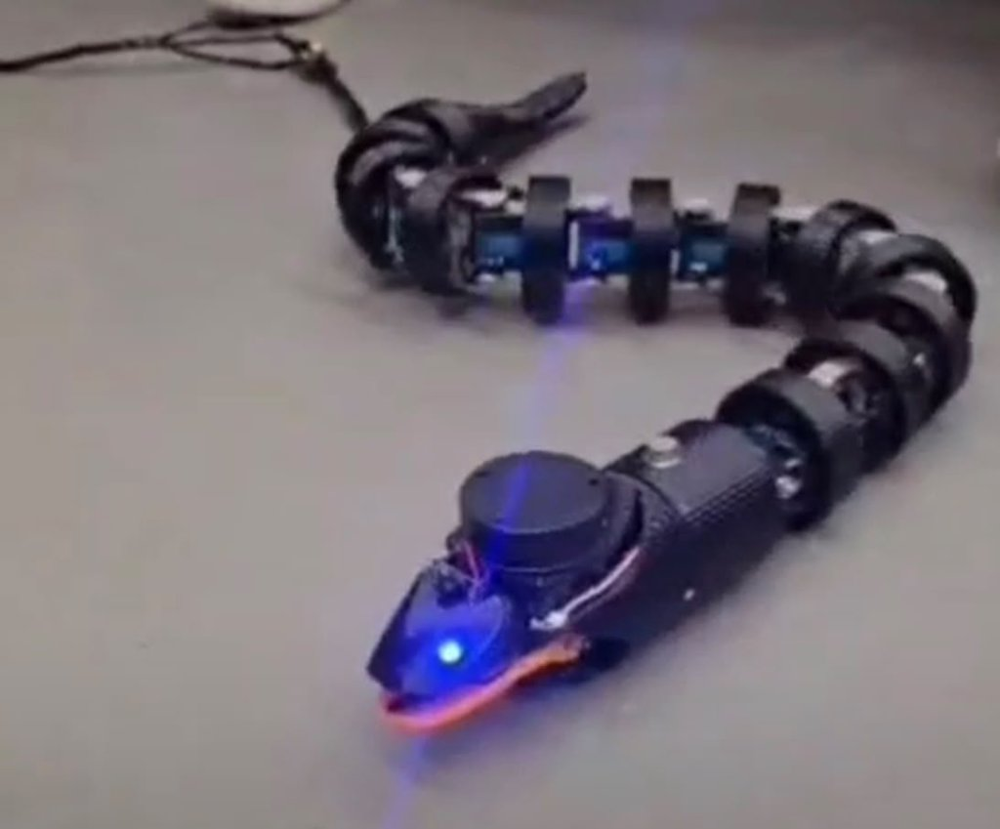
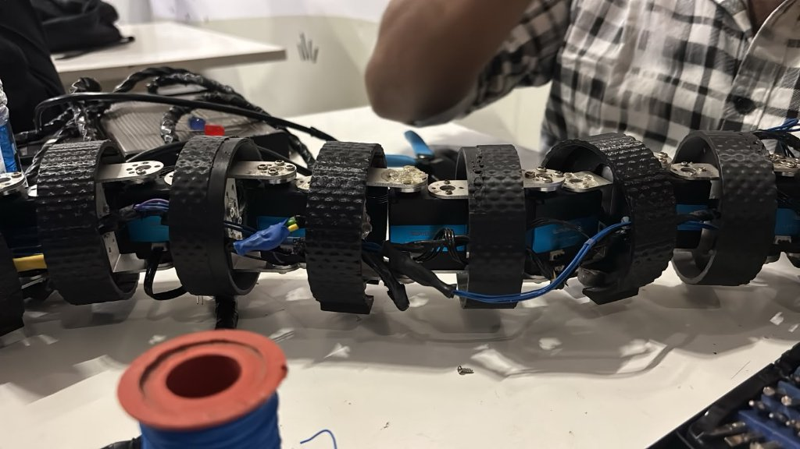
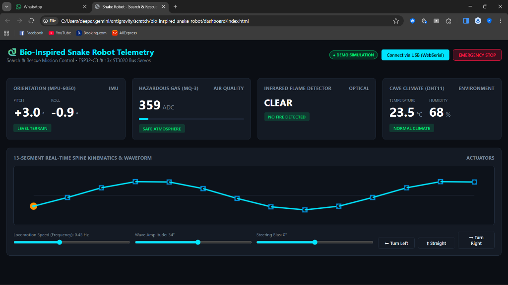

# Bio-Inspired Modular Snake Robot for Search & Rescue Exploration


<p align="center">
  
</p>

An autonomous bio-inspired modular snake robot designed for subterranean and rough-terrain search-and-rescue operations. Powered by an **ESP32-C3** master microcontroller and **13 daisy-chained high-torque serial bus servos (Waveshare ST3020 / ST3215)**, the robot navigates narrow cave tunnels and rocky terrain using Hirose Serpenoid locomotion equations (Central Pattern Generator).

The robot is equipped with a digital search-and-rescue sensor package (**MPU-6050 IMU, MQ-3 gas sensor, infrared flame detector, and DHT11 climate sensor**), plus a 3D digital twin simulation built in **PlayCanvas WebGL**.

---

## Table of Contents
- [Robot Overview & Features](#robot-overview--features)
- [Hardware Architecture & Bill of Materials](#hardware-architecture--bill-of-materials)
- [System Architecture](#system-architecture)
- [Kinematics & Serpentine Locomotion](#kinematics--serpentine-locomotion)
- [Repository Structure](#repository-structure)
- [Firmware Setup (Arduino / ESP32-C3)](#firmware-setup-arduino--esp32-c3)
- [3D Simulation (PlayCanvas)](#3d-simulation-playcanvas)
- [Wiring & Electrical Connection](#wiring--electrical-connection)
- [License](#license)

---

## Robot Overview & Features

- **Bio-Inspired Locomotion:** Generates continuous lateral undulation waves (Hirose Serpenoid curve) across 13 articulated joints.
- **Daisy-Chained Serial Bus:** Controls 13 high-precision magnetic encoder servos using a single half-duplex UART line via `SyncWrite` packets at 1 Mbps.
- **Custom Modular Mechanical Links:** 
  - Anodized aluminum U-brackets with top flat clamp arms.
  - 3D-printed circular knurled wheel collars providing anisotropic ground friction.
  - Streamlined head assembly with orange underbelly skid, top-mounted ESP32 deck, and forward-pointing targeting red laser.
- **Search-and-Rescue Sensor Suite:**
  - **MPU-6050 6-DoF IMU:** Real-time roll/pitch feedback to detect steep inclines, uneven boulders, or rollover states.
  - **MQ-3 Gas Sensor:** Detects dangerous combustible gases and vapors in confined underground pockets.
  - **IR Flame Detector:** Real-time fire and thermal hotspot detection.
  - **DHT11 Sensor:** Continuous ambient cave temperature and relative humidity monitoring.

---

## Hardware Architecture & Bill of Materials

<p align="center">
  
</p>

| Component | Specification / Model | Quantity | Purpose |
| :--- | :--- | :---: | :--- |
| **Microcontroller** | ESP32-C3 Dev Module (RISC-V) | 1 | Master kinematic gait generation & sensor telemetry |
| **Actuators** | Waveshare ST3020 / ST3215 Serial Bus Servos | 13 | High-torque daisy-chained articulated joint motors |
| **Mechanical Collars** | 3D-printed knurled circular rings | 13 | Ground traction & anisotropic lateral friction |
| **Linkage Clamps** | Aluminum flat link arms & U-brackets | 13 | Structural inter-segment joint linkages |
| **IMU Sensor** | MPU-6050 (6-DoF I2C) | 1 | Pitch/Roll orientation & rollover detection |
| **Gas Sensor** | MQ-3 Alcohol / Combustible Gas Sensor | 1 | Underground hazardous gas detection |
| **Fire Sensor** | Infrared Flame Detection Module (DO) | 1 | Fire / IR hotspot scanning |
| **Climate Sensor** | DHT11 Digital Sensor | 1 | Ambient cave temperature & humidity |
| **Battery Power** | 7.4V 2S LiPo (35C, ≥3000mAh) | 1 | High-current power delivery (8A–10A peak) |
| **Buck Converter** | 5V 3A DC-DC Step-Down | 1 | Clean regulated power for ESP32 & sensors |

---

## System Architecture

```
                  +-----------------------------------------------+
                  |          ESP32-C3 Master Controller           |
                  +-----------------------------------------------+
                         |                                 |
           (Hardware UART - 1 Mbps)                 (I2C & ADC / GPIO)
                         |                                 |
                         v                                 v
        +---------------------------------+   +-------------------------+
        | Waveshare ST3020 Bus Driver     |   | Sensor Suite:           |
        +---------------------------------+   | - MPU-6050 IMU (I2C)    |
                         |                    | - MQ-3 Gas Sensor (ADC) |
                         v                    | - Flame Sensor (GPIO)   |
        +---------------------------------+   | - DHT11 Climate (GPIO)  |
        | Daisy-Chained Bus Line          |   +-------------------------+
        | [ID: 1] -> [ID: 2] ... [ID: 13] |
        +---------------------------------+
```

---

## Kinematics & Serpentine Locomotion

The robot synthesizes lateral undulation using Hirose’s Serpenoid mathematical curve:

$$\theta_i(t) = A \cdot \sin(2\pi f t + (i - 1)\Delta\phi) + \gamma$$

Where:
- $\theta_i(t)$: Target angle for the $i$-th serial bus servo joint.
- $A$: Wave amplitude in degrees (typically $30^\circ - 40^\circ$).
- $f$: Slithering frequency in Hertz (typically $0.4\text{ Hz} - 0.7\text{ Hz}$).
- $\Delta\phi$: Spatial phase shift between consecutive segments (typically $35^\circ - 45^\circ$).
- $\gamma$: Directional steering bias offset ($\gamma < 0 \implies \text{Left turn}$, $\gamma > 0 \implies \text{Right turn}$).

The ESP32 calculates these target angles at a consistent **40 Hz (25 ms interval)** and dispatches them across the serial line inside a single **`SyncWritePosEx`** broadcast packet.

### How the Sine Wave Moves the Snake
1. **Wave Propagation:** A continuous sine wave travels backward down the spine ($i=1 \to 13$).
2. **Anisotropic Friction:** The passive circular wheel collars allow low resistance along the forward axis while blocking lateral slipping ($\mu_n \gg \mu_t$).
3. **Thrust Generation:** The normal ground reaction force resolves into net forward thrust driving the robot along narrow paths.

| Joint (Segment) | Phase Offset | $t = 0.00\text{s}$ (Angle / Tick) | $t = 0.25\text{s}$ (Angle / Tick) | $t = 0.50\text{s}$ (Angle / Tick) |
| :--- | :---: | :---: | :---: | :---: |
| **Servo 01 (Head)** | $0^\circ$ | $+0.0^\circ$ / 2048 | $+24.7^\circ$ / 2330 | $+35.0^\circ$ / 2446 |
| **Servo 04** | $120^\circ$ | $+30.3^\circ$ / 2393 | $+9.1^\circ$ / 2151 | $-17.5^\circ$ / 1849 |
| **Servo 07** | $240^\circ$ | $-30.3^\circ$ / 1703 | $-33.8^\circ$ / 1663 | $-17.5^\circ$ / 1849 |
| **Servo 10** | $360^\circ$ | $+0.0^\circ$ / 2048 | $+24.7^\circ$ / 2330 | $+35.0^\circ$ / 2446 |
| **Servo 13 (Tail)** | $480^\circ$ | $+30.3^\circ$ / 2393 | $+9.1^\circ$ / 2151 | $-17.5^\circ$ / 1849 |

> 📖 **Full Numerical Dataset & Derivation:** See [docs/kinematics.md](docs/kinematics.md) for the complete 13-joint angle/tick data matrix across the full cycle and ground reaction force analysis.

---

## Repository Structure

```
├── README.md                      # Project documentation and build guide
├── LICENSE                        # MIT License
├── .gitignore                     # Build and temporary files filter
├── assets/
│   └── images/                    # Robot hardware & dashboard screenshots
├── dashboard/
│   └── index.html                 # Mission Control Web Dashboard (WebSerial + Simulation)
├── firmware/
│   └── snake_controller/
│       └── snake_controller.ino   # Complete integrated ESP32-C3 firmware
├── simulation/
│   └── SnakeRobot.js              # Complete PlayCanvas 3D digital twin script
└── docs/
    ├── hardware_setup.md          # Wiring diagrams and power distribution
    └── kinematics.md              # Mathematical gait formulation & CPG tuning
```

---

## Firmware Setup (Arduino / ESP32-C3)

1. **Install Arduino IDE** and add the ESP32 board manager:
   ```
   https://raw.githubusercontent.com/espressif/arduino-esp32/gh-pages/package_esp32_index.json
   ```
2. **Install Required Libraries:**
   - `SCServo` (by Feetech / Waveshare)
   - `Adafruit MPU6050`
   - `Adafruit Unified Sensor`
   - `DHT sensor library`
3. Select **Tools** → **Board** → **ESP32C3 Dev Module**.
4. Open `firmware/snake_controller/snake_controller.ino` and click **Upload**.

---

## Search & Rescue Mission Control Dashboard

<p align="center">
  
</p>

The repository includes a dark-mode web telemetry dashboard located at [`dashboard/index.html`](dashboard/index.html):

- **Real-Time Sensor Telemetry:** Live gauges for **MPU-6050 Pitch & Roll, MQ-3 Gas level, Flame alerts, and DHT11 Climate**.
- **13-Segment Dynamic Spine Kinematics:** Live canvas rendering of the current serpentine wave across all 13 ST3020 servos.
- **WebSerial 1-Click Connect:** Plug the ESP32-C3 into your laptop via USB, click **"Connect via USB"** in Google Chrome or Edge, and stream live sensor data straight from the physical snake!
- **Interactive Controls:** Sliders for wave amplitude, slithering frequency, and steering buttons (**Left**, **Straight**, **Right**, **Emergency Stop**).

To launch: simply double-click [`dashboard/index.html`](dashboard/index.html) in any web browser.

---

## 3D Simulation (PlayCanvas)

The digital twin allows full 3D simulation inside any modern browser without downloading local software:

1. Create a free project on [PlayCanvas](https://playcanvas.com/).
2. Create a script named `SnakeRobot.js` and paste the contents of `simulation/SnakeRobot.js`.
3. Attach `SnakeRobot.js` to an empty entity in your scene and click **Launch**.
4. Watch the bio-inspired snake robot slither across a waving 3D grass meadow into an enclosed rock cavern!

---

## Wiring & Electrical Connection

See [docs/hardware_setup.md](docs/hardware_setup.md) for full schematic pinouts, logic-level considerations, and power isolation guidelines.

---

## License

This project is licensed under the MIT License - see the [LICENSE](LICENSE) file for details.
